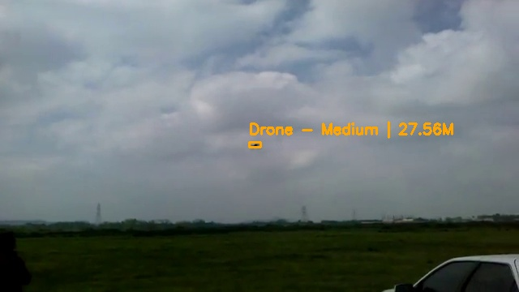

# Drone Proximity Detection System

A lightweight system that detects drones near a facility, estimates how far away they are, and sounds an alarm when one stays close for too long.



## Overview

The system is designed to be integrated with cameras installed in security facilities or sensitive locations. Its purpose is to detect and alert the organization whenever a drone is nearby, whether it is a surveillance drone or a combat drone.

It runs two models together: one detects and tracks drones in the camera feed, and a depth estimation model estimates how far each drone is. The estimated distance is classified as Close, Medium, or Far. If a drone stays close for 8 continuous seconds, the system treats it as a potential threat.

| Class | Label |
|-------|-------|
| 0 | Drone |

| Distance | Default threshold | Box color |
|----------|-------------------|-----------|
| Close | under 20.0 m | Red |
| Medium | under 40.0 m | Orange |
| Far | 40.0 m and above | Green |

These are default values. They can be modified and customized to fit your specific requirements.

## Features

- Drone detection with a custom-trained YOLO11n model (`Drone.pt`)
- ByteTrack tracking, so each drone keeps its own ID, timer, and distance reading
- Distance estimation with a YOLO26 depth model (`yolo26n-depth.pt`), using the median depth from the center of the drone's bounding box
- Exponential smoothing on the distance reading, so the Close / Medium / Far label doesn't flicker
- Adjustable distance thresholds
- 8-second rule to reduce false alarms
- When a potential threat is confirmed: a full-frame image is saved and a loud alarm plays (`alert.mp3`)
- Every confirmed threat is logged to a local SQLite database

## Model Evaluation

These numbers cover the drone detection model (`Drone.pt`). It was evaluated on a held-out validation set of 38 images (49 instances).

| Metric | Value |
|--------|-------|
| Precision | 0.939 |
| Recall | 0.934 |
| mAP50 | 0.984 |
| mAP50-95 | 0.761 |

Model: YOLO11n (fused), 101 layers, 2,582,347 parameters, 6.3 GFLOPs.

mAP50 of 0.984, with precision and recall both above 0.93, shows strong detection reliability at a standard IoU threshold. The validation set is small, so treat these numbers as a good sign rather than a thorough benchmark.

## Design Decisions

**The 8-second rule.** The rule is intended to reduce false alarms and minimize the chances of flagging drones that briefly pass near the facility, such as personal drones used for photography. If a drone remains close to the facility for 8 continuous seconds, the system classifies it as a potential threat, captures an image, and triggers a loud alarm to alert personnel and warn them of the drone's presence.

**Adjustable distance thresholds.** The distance thresholds, 20.0 for Close and 40.0 for Medium, are default values. Change them to match your camera setup and your facility.

## Important Note

The depth estimation model is not 100% accurate. It only provides an estimated distance, which can sometimes lead to noticeable issues, such as classifying a distant drone as being close.

For more accurate and reliable distance estimation, consider experimenting with other depth estimation models outside the YOLO ecosystem, or try larger versions of YOLO's depth estimation models. However, larger models generally require more computational resources and consume more processing power.

## How It Works

1. Each camera frame goes through the drone detection model with ByteTrack, which gives every drone an ID.
2. The depth model estimates a depth map for the same frame. The system takes the median depth from the center of each drone's bounding box and smooths it over time.
3. The smoothed distance is classified as Close, Medium, or Far, and the drone is drawn with a color-coded box and a label showing its ID, status, and distance.
4. While a drone is Close, an 8-second timer runs. If the drone leaves the Close range, the timer resets.
5. When the timer reaches 8 seconds, the system saves a full-frame image, plays the alarm, and logs the event to SQLite.

## Database

`DataBase.db`, table `info`:

| Column | Type | Description |
|--------|------|-------------|
| Id | INTEGER PRIMARY KEY AUTOINCREMENT | Event ID |
| Distance | REAL | Estimated distance when the alarm triggered |
| Screenshot | TEXT | File name of the saved image |
| Confidence | REAL | Detection confidence |
| Date | TEXT | Timestamp of the event |

## Getting Started

### Install

```bash
git clone https://github.com/i0nlyaziz/Drone-Proximity-Detection-System.git
cd Drone-Proximity-Detection-System
pip install -r requirements.txt
```

### Model weights

The models aren't stored in the repo. Download `Drone.pt` and `yolo26n-depth.pt` from the [Releases page](https://github.com/i0nlyaziz/Drone-Proximity-Detection-System/releases) and place them in the `weights/` folder.

### Run

```bash
python main.py
```

This opens the camera (index 0) and shows the annotated feed in a window. Press `q` to quit.

The model paths, the camera index, and the distance thresholds are set directly in `main.py`. Open the file to change them.

## Project Structure

```
Drone-Proximity-Detection-System/
├── README.md
├── LICENSE
├── requirements.txt
├── .gitignore
├── main.py                       # detection, depth estimation, alarm, and database logging
├── alert.mp3                     # alarm sound
├── weights/
│   ├── Drone.pt                  # drone detection model (not tracked in git, see above)
│   ├── yolo26n-depth.pt          # depth estimation model (not tracked in git, see above)
│   └── README.md
└── results/
    └── demo.jpg                  # sample detection output
```

## Tech Stack

Ultralytics YOLO (detection and depth estimation), ByteTrack, OpenCV, NumPy, pygame, SQLite

## Limitations

- Distances come from a depth model, so they are estimates, not measurements
- The 8-second rule trades response time for fewer false alarms: a drone that only passes through the close zone briefly will not trigger the alarm
- If a drone is missed by the detector for even one frame, its tracking state is cleared and the 8-second timer starts over
- The camera index, model paths, and thresholds are hardcoded in `main.py`
- `DataBase.db` and the saved images are created while the system runs; they aren't part of the repo

## License

MIT, see [LICENSE](LICENSE) for details.